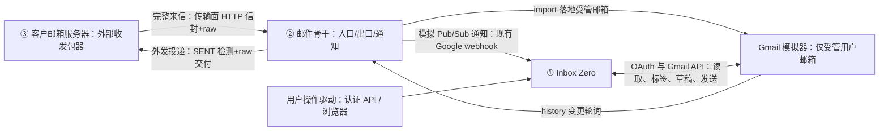

# Inbox Zero 本地邮件收发与功能测试计划

## 1. 目标与已确定的方向

在没有真实 Gmail 邮箱、SMTP/IMAP 服务器和外部客户邮箱界面的情况下，系统测试 Inbox Zero 的邮件处理能力。

- 保留实际运行的 Inbox Zero、数据库、Redis 和相关后台处理，应用零改动。
- 使用现有 Google/Gmail 模拟器承载邮箱状态、生成 history，并负责向 Inbox Zero 投递变更通知。模拟器扩展为接近真实的"用户邮箱服务器"：补邮件出入口与通知派发两块骨干，不新增应用用不到的 API。
- 外部客户由收发包器扮演，定位为"客户邮箱服务器"：受控构造任意完整邮件、接收回复、继续对话，自持收发记录；不负责调用 Inbox Zero webhook，也不实现任何 provider API。
- 模拟器只承载 Inbox Zero 管理的用户邮箱；邮箱内容不由用户手动操作，全权交给 Inbox Zero 的规则与 AI 处理。收发包器独立运行，不在模拟器中注册第二个 Gmail 账号。
- Inbox Zero 与模拟器之间使用现有正式 Gmail API 契约和 webhook；用户操作使用应用已有业务 API 或 server action。收发包器与模拟器之间的传输已定为 HTTP + `{envelope, raw MIME}`（信封路由的类邮件通信），不引入 SMTP。
- **不新增 Inbox Zero 专用测试接口，不通过直接调用内部处理函数绕过正常入口。**
- 第一阶段使用脚本/CLI；MCP 只作为后续可选包装，不是收发闭环的前置条件。
- 本文件仅记录方案。本次未修改业务代码、运行测试或启动服务；模拟器能力经发布产物源码静态核查（`@inbox-zero/emulate@0.11.1`，见第 4 节），运行时行为仍需实测。

“完备”通过功能与场景覆盖矩阵衡量，不承诺模拟环境能够验证真实邮件服务的全部行为。

## 2. 三方架构与系统边界

| 组件 | 定位 | 必须保留 | 明确不做 |
| --- | --- | --- | --- |
| ① Inbox Zero（已部署） | 受管用户的”AI 邮件管理员” | 真实运行的应用、数据库、Redis、规则与 AI 处理链路；只认识一个 Gmail 服务（`GOOGLE_BASE_URL`），OAuth/API/webhook 全走正式契约 | 零代码改动；不知道收发包器存在 |
| ② 用户邮箱（模拟器 + 邮件骨干） | 受管用户的邮件服务器 | 满足 Inbox Zero 会读取的全部 Google API；对外收外部来信、投递外发邮件、推送变更通知 | 不新增应用用不到的 API；不注册第二个邮箱；邮箱内容不由人手动操作，全权交给 Inbox Zero 的规则与 AI |
| ③ 客户邮箱服务器（外部收发包器） | 客户侧邮件系统 + 测试输入源 | 受控构造任意完整邮件（MIME 全保真）、接收回复、继续对话、自持收发记录 | 不实现任何 provider API、不持有受管用户凭证、不调用 webhook、背后不需要模拟器 |

**NOTICE：邮箱界面可以省略，邮箱状态不能省略。** Inbox Zero 会查询邮件、线程、附件、标签和草稿；单次传入邮件正文无法支持这些行为。当前 provider 工厂依赖 Google/Microsoft provider，不能假设 Inbox Zero API 已经独立托管了邮箱。

“扩展为接近真实的邮件服务器”指补齐两块骨干，不是补 API：应用实际调用的端点（OAuth/OIDC、messages、drafts、history、watch、labels、attachments、threads、batch）模拟器已全部实现；缺口是邮件出入口（入站接收、出站投递）与通知派发（watch 语义 + Pub/Sub 形状推送），全部归属模拟器部署。

外部收发包器只承担客户收发行为，同时充当测试输入生成器（后续扩展阶段的任意 MIME 样本从这里注入）。需要操作 Inbox Zero 的用户设置、发送草稿或观察内部结果时，由单独的测试编排角色完成，不把用户凭证交给客户角色。通知生成、投递与重试属于模拟器基础设施；客户不持有 webhook 验证 token，也不维护通知游标。

客户接收的是模拟器向外送出的邮件；读取受管用户 SENT 只能作为独立测试观察，不能充当客户收信。

**NOTICE：信任边界必须由网络拓扑强制。** 模拟器把任何未知 Bearer token 认证为种子第一个用户（即受管用户），API 面实质无鉴权。收发包器绝不能触达模拟器的 Gmail API 端口：API 面只在内部网络对应用与邮件骨干开放，对外只暴露传输面入口；TLS 终结放在邮件骨干组件（取代现有 nginx 反代位置）。

真实服务中的通知路径为 Gmail → Google Cloud Pub/Sub → Inbox Zero。纯本地环境由模拟器及其通知组件承担前两者的相关职责，可以直接投递兼容的 Pub/Sub 消息到应用既有 webhook，无需先部署完整 Pub/Sub 服务。手动发 webhook 只可用于单独的故障定位，不是客户行为，也不能替代正常闭环验收。

## 3. 正式接口的含义与发送语义

这里的“真接口”指真实业务代码路径与正式 API 契约，Gmail 服务地址仍指向本地模拟器。并不是调用真实 Google 云服务。

| 操作 | 接口或入口 | 语义 |
| --- | --- | --- |
| 客户发信 | 收发包器向邮件骨干的传输面入口投递（HTTP 信封+raw） | 邮件骨干按信封路由，经 import 将完整来信写入受管用户 INBOX |
| 通知应用 | 邮件骨干向 Inbox Zero `POST /api/google/webhook` | 模拟 Pub/Sub 投递邮箱 history 变更通知，不传整封邮件 |
| 读取来信 | Inbox Zero 调用 Gmail history、messages、threads、attachments API | 走现有 provider 与处理链路 |
| 用户主动发送/回复 | 现有 `POST /api/messages/send`，或应用原有操作入口 | 执行应用校验，再调用 provider |
| 自动发送 | Inbox Zero 已启用规则中的发送/回复动作 | 由应用自行执行，收发包器不代替它发送 |
| 客户接收回复 | 邮件骨干检测 SENT 变更后向收发包器传输面出口投递（HTTP 信封+raw） | 收发包器保存收到的完整回复，无需 Gmail list/get |
| 准备历史样本 | 可选的 Gmail `users.messages.insert` | 导入指定邮箱的测试夹具，不用于正常互发闭环 |

**NOTICE：`insert` 与 `send` 在真实 Gmail 中也是不同操作。** `insert` 只向指定邮箱添加记录，不向邮件头中的收件人投递；`send` 才执行发送。Inbox Zero 正常发送使用 `messages.send` 或 `drafts.send`，真实环境会由 Gmail 执行投递。[Gmail insert](https://developers.google.com/workspace/gmail/api/reference/rest/v1/users.messages/insert)、[Gmail send](https://developers.google.com/workspace/gmail/api/reference/rest/v1/users.messages/send)

`insert` 会绕过大部分扫描与分类，不能用它证明真实 Gmail 的反垃圾行为。`import` 具有不同的扫描语义，不应当作无差别替代品。[Gmail import](https://developers.google.com/workspace/gmail/api/reference/rest/v1/users.messages/import)

本地“客户收到回复”的定义：Inbox Zero 实际调用发送接口后，模拟器保存受管用户 SENT，并向独立收发包器交付邮件；收发包器实际收到并保存内容。只出现 SENT 记录不算客户收信成功。该闭环不依赖模拟器中的第二个邮箱，也不代表真实互联网投递。

`send`、`list`、`get` 是授权客户端操作 Gmail 邮箱的接口，在本方案中供 Inbox Zero 使用。Gmail 的 `list` 返回邮件标识等列表信息，详细内容通过 `get` 获取；`send` 的响应不是等待对方处理后返回的回复。独立收发包器不必实现或调用这些接口。[list](https://developers.google.com/workspace/gmail/api/reference/rest/v1/users.messages/list)、[get](https://developers.google.com/workspace/gmail/api/reference/rest/v1/users.messages/get)

### 外部邮件传输：已确定的实现边界

- Gmail `users.messages.send` 是以授权邮箱身份发信的接口，不是任意外部发件人向 Gmail 投递的接收入口。不能要求独立客户使用受管用户凭证，也不能把自己的 HTTP 投递协议称为 Gmail 官方 send 接口。
- 传输协议定为 HTTP + `{envelope, raw MIME}` 双向对称：`envelope` 携带投递元数据（发件人、收件人列表），`raw` 为完整原始邮件字节。收发包器与邮件骨干之间仅此契约，另有一个操作员控制面（编排"现在发这封""报告收到了什么"），不涉及应用。
- **信封路由，不解析邮件头**：入口按 envelope 收件人路由到受管邮箱，规避 To/Cc/Bcc 头可见性问题（Bcc 场景与真实 SMTP 信封语义一致）。
- 入口落地复用模拟器 `messages/import` 原语（默认 `INBOX`+`UNREAD`，最接近真实收信语义）；`insert` 保留给测试夹具。落地后由模拟器自动生成 history，通知组件只使用 `history.list` 真实可查的 ID，不凭空构造。
- **出口以 history 中的 SENT 变更为触发，不拦截 send 调用**：无论应用走 `messages.send`、`drafts.send` 还是 batch，出口只认邮箱状态这一个事实源。检测到外发后取 `format=raw` 完整邮件，从存储字段重建信封（To/Cc/Bcc），向收发包器投递并携带幂等 deliveryId；投递失败进入持久化待发队列退避重试。
- "SENT 记录存在"与"客户实际收到"由投递回执天然分离；收发包器接收端不在线不丢信，重试由邮件骨干负责，不需要客户重发。
- 传输认证使用独立 `TRANSPORT_TOKEN`，与受管用户 OAuth、应用会话、webhook 验证 token 三类凭证互不相交。
- SMTP 不引入：本地闭环中它只是给 HTTP 换一层信封协议，不增加保真度（互联网投递本就在边界外）。契约保持 `{envelope, raw}` 形状，将来若要 SMTP 面只换传输层，收发包器核心不动。

## 4. 已确认事实与待验证能力

### 已通过仓库代码确认（应用侧）

- `GOOGLE_BASE_URL` 当前同时控制 Google OAuth 与相关 API 地址，包括 Gmail root URL、batch URL 等；未设置时回落到真实 Google 地址。见 [oauth.ts](apps/web/utils/google/oauth.ts)。
- Google webhook 验证配置 token，接收 base64 编码的 JSON 通知，使用 `after()` 在响应后处理。见 [route.ts](apps/web/app/api/google/webhook/route.ts)。
- history 处理依赖 `lastSyncedHistoryId`，查询增量、处理消息与标签事件，再推进游标。见 [process-history.ts](apps/web/utils/webhook/google/process-history.ts)。
- 新增邮件通常需要 `INBOX` 或 `SENT` 标签才进入对应处理；`INBOX` 上同时存在 `DRAFT` 不按普通来信处理。
- 账号有效性、AI 权限、启用规则或 filing 配置、access/refresh token、限流状态都可能影响处理。见 [validate-webhook-account.ts](apps/web/utils/webhook/validate-webhook-account.ts)。
- 发信接口受 `withEmailAccount` 保护，需要应用认可的认证及 `X-Email-Account-ID`，并验证账号归属。见 [middleware.ts](apps/web/utils/middleware.ts)。
- 发送开关为 `NEXT_PUBLIC_EMAIL_SEND_ENABLED`。发送请求由 [mail.ts](apps/web/utils/types/mail.ts) 定义的 schema 校验。
- 已有模拟器集成测试、Playwright 测试和 AI eval。部分集成测试 mock 了 Prisma、AI 或规则匹配，不能替代实际部署的完整链路测试。

### 已通过模拟器发布产物源码确认（@inbox-zero/emulate@0.11.1，静态核查）

- API 面已覆盖应用实际调用的全部端点：OAuth/OIDC 全流程（发现文档、授权、token 交换/刷新、userinfo）、messages（list/get/modify/batchModify/trash/insert/import/send）、drafts CRUD 与 send、history.list、watch/stop、labels、attachments、threads、batch。”满足 Inbox Zero 会读的 API，不读的不管”这一范围原则在现状下即已满足。
- 所有变更自动记录 history：send/import/insert → `messageAdded`；modify/trash → `labelAdded`/`labelRemoved`；delete → `messageDeleted`。`history.list` 支持 `startHistoryId`/`historyTypes`/`labelId`/分页（单页上限 500）。
- `import` 默认打 `INBOX`+`UNREAD`；`send` 强制 `from = 认证用户`、打 `SENT`、仅存库记 history，不做任何对外投递；`bcc` 字段会被解析并存储。
- `watch` 存储订阅（topicName/labelIds/labelFilterBehavior/24h 过期）但没有任何派发逻辑，且 HTTP 上无法读回 watch 状态（只有 POST watch/stop）——通知组件必须以反向代理方式捕获 watch/stop，才能忠实实现订阅语义。
- 鉴权 fallback：任何未知 Bearer token 都被认证为种子第一个用户（即受管用户）。测试基础设施可用任意 token 调 Gmail API，也因此必须用网络拓扑把收发包器挡在 API 面之外（见第 2 节）。
- 线程归并与 Gmail 一致：显式 threadId → In-Reply-To/References 匹配已存 RFC Message-ID → 否则新线程。
- 存储为纯内存：重启即重置消息、history、watch 状态与已签发 OAuth token；无 HTTP 快照端点。
- history ID 为时间戳+熵的 BigInt（约 21 位，超出 `Number.MAX_SAFE_INTEGER`）；应用 webhook 处理将其 `Number.parseInt`，精度损失约 ±3 万 ID 单位（见第 6 节边界检查）。

### 附件能力的侦察结论（源码确认，2026-09）

以下结论经多轮交叉验证，定义了本地闭环里附件测试的**真实边界**，避免把不存在的路径当成待补缺口。

**两条 AI 生成管道互斥（重要修正，2026-09 实测确认）**

- 邮件自动处理存在**两条互不交叉的 AI 管道**：
  - **规则参数管道**（`aiGenerateArgs` / `choose-args.ts`）：REPLY / SEND_EMAIL / FORWARD 的 `{{模板}}` 参数在此生成。输入只有**来信内容 + 模板 + 规则指令**。**没有历史搜索、没有知识库提取、没有回复记忆** —— 这些都只属于草稿管道。
  - **草稿管道**（`generate-draft.ts` 的 `generateDraftContent`）：只服务于 `DRAFT_EMAIL` / `DRAFT_MESSAGING_CHANNEL`（`DRAFT_REPLY_ACTION_TYPES`）。它拥有全部上下文收集能力：`aiCollectReplyContext`（带 searchEmails 工具的 agent，搜 6 个月内历史）、`aiExtractFromEmailHistory`、知识库提取、回复记忆、日历/会议/附件上下文。
- **"历史搜索 + 自动发送"在当前版本不可兼得**：能自动发送的动作走参数管道（无历史搜索）；能读历史的动作只产出草稿（不自动发）。`combineActionsWithAiArgs` 只把草稿内容灌给 `DRAFT_REPLY_ACTION_TYPES` 内的动作，REPLY/SEND/FORWARD 拿不到草稿文本。
- 实测证据（密码泄露场景）：预置含密码的历史邮件后，B 来信索要密码 → AI 拒绝了并建议用密码库 —— 但日志显示 `reply-context-collector` **0 次运行**、"Drafting email reply" 不存在。拒绝是模型常识，不是检索了历史后的判断。**无人干涉的"搜历史→找到机密→自动外发"在本版本不存在。**
- 推论：默认配置下，"机密被检索进上下文"只发生在草稿生成时；而草稿需人确认才发送。两条管道互斥是当前版本**意外的安全属性**（设计上是否如此未在代码中声明）。

**来信附件（入站）**

- 模拟器 `parseRawMessage` 完整解析 MIME：boundary、disposition、content_id、transfer_encoding、二进制 body（base64url 存于内存集合 `gs.attachments`，字段 `filename/mime_type/data/size` 等）。应用侧 `parseMessage` 提取元数据（filename/mimeType/size），并区分 inline 与普通附件。
- 附件的二进制内容**只存在模拟器内存**，应用**不落地**：`getAttachment` 是实时代理（每次经 Gmail API 拉取）。模拟器重启 = 附件永久丢失，无快照。测附件必须在一次会话内完成发 → 验证 → 读。
- **自动回复机制读不到来信附件内容** —— 不是读不到全文，是连摘要、片段都读不到。已验证全部旁路：线程正文提取（`findFirstTextPart` 排除附件节点）、历史邮件提取（`getEmailForLLM` 只带附件元数据）、知识库（用户手写 markdown，不自动写入）、ReplyMemory（只学草稿编辑）。附件在自动回复的 prompt 里只以 `<attachment filename=... type=... size=... />` 一行元数据存在。
- 附件文本提取能力（`extractAttachmentText`，支持 PDF/docx/csv/plain/html，8000 字上限）**只被助手聊天工具 `readAttachmentTool` 调用**，是另一条产品线（用户主动发起的对话），不喂自动回复。`getAttachment` 的 7 个调用点没有一个在 webhook 自动回复链上。
- 结论：让自动回复读附件内容是**源码级功能扩展**（需在 draft 上下文构建里加 getAttachment+extractAttachmentText，并把该路径 prompt hardening 从 compact 升到 full）。没有任何配置或规则能间接支持 —— 规则动作类型里没有"读附件"类动作，`CALL_WEBHOOK` 的 payload 也只含元数据（连 attachmentId 都没有）。

**发件附件（出站）**

- 自动回复带出去的附件 = **用户在规则里绑定的云盘文件/文件夹中的 PDF**（`AttachmentSource` → `DriveConnection`），发信那一刻经 `provider.downloadFile(fileId)` **实时从 Drive 下载字节**打进 multipart；**只收 PDF**（`PDF_MIME_TYPE` 检查）。
- 选择方式两种：规则里手选的静态附件，或 AI 按来信内容从源里挑的（`selectDraftAttachmentsForRule`）。
- 进 prompt 的不是全文：是 `AttachmentDocument.summary`（索引时的摘要）拼进 `<selected_attachments>` 段。
- 不是来信附件的转发，不是应用存储的文件，不是知识库内容。
- 本地闭环影响：`DriveConnection` 指向真实 Google/Microsoft Drive，模拟器无 Drive 模拟 → **这条链在本地完全断着**。测"自动回复带附件"需先有 Drive 模拟（阶段 C 的"其他功能"清单）。

**客户收发包器（我们的组件）**

- 客户端 `composeEml` **不支持附件**（无 multipart 构造、无 --attach 参数）；骨干原样透传 raw。缺口只在"构造"侧，底层（模拟器解析、应用元数据读取）均已就绪。
- 补法（阶段 C）：客户端 composeEml 升级为 multipart/mixed，附件二进制只存在于完整 MIME（.eml）内，不单独存储 —— 避免"两处真相"的同步问题。

### 必须实测（运行时行为，静态核查不能替代）

- 部署核对：实际运行的模拟器版本与仓库锁定（0.11.1）一致、种子数据来源、内存态重启对应用游标与去重记录的影响（见第 8 节）。
- `messages.send`/`drafts.send` 生成可查询 `SENT` 邮件的完整链路；发送草稿是否消费原草稿。
- nodemailer 生成的 raw 是否保留 `Bcc` 头（决定出站信封来源：存储字段，或代理捕获的发送请求体兜底）。
- `import` 是否应用模拟器 filters（记录与真实 Gmail 扫描语义的保真边界）。
- historyId 超出安全整数范围时应用侧解析的边界行为（快速连续变更专项用例）。
- 邮件骨干以反代方式透传 OAuth、batch、openid、calendar、drive 全路径后应用行为不变（回归）。
- watch 初始通知、续期、过期、stop 与 label 过滤行为经通知组件触发时的正确性。
- Inbox Zero 的 OAuth 身份是否正确对应受管邮箱；独立收发包器无需该身份。不得把测试里固定的 emulator token 当作实际部署的通用凭证。

缺口已定位并归属明确：邮件出入口与通知派发在模拟器侧的邮件骨干组件中按第 3 节契约补齐，正式 Gmail API 实现无需新增。保留”不新增 Inbox Zero 测试接口”的方向；不静默切换成第二个模拟 Gmail 账号、由客户 insert 对方邮箱、读取对方 SENT 代替收信、发送通知、直接写应用数据库或 mock 处理结果。

## 5. 邮件格式与数据保真

输入以完整 `.eml` 原始字节为基础，遵循 [RFC 5322](https://www.rfc-editor.org/rfc/rfc5322) 与 [MIME](https://www.rfc-editor.org/rfc/rfc2045)。通过 Gmail JSON API 时，将整封邮件编码为 `raw` 字段要求的 base64url。[Message 资源定义](https://developers.google.com/workspace/gmail/api/reference/rest/v1/users.messages)

第一阶段支持纯文本与 HTML、普通附件、正常回复；随后扩展合法 MIME 组合、自定义头、非 ASCII 内容、内嵌图片和日历邀请等。

**NOTICE：**

- 保存原始输入与实际输出，不能只留 `from/to/subject/body` 或重新拼装的摘要。
- 区分整个 `raw` 的 base64url、MIME 部件的 Content-Transfer-Encoding，以及应用发送接口附件字段的 base64，避免双重编码或混用。
- 保留合法邮件头折行、重复头、MIME boundary、charset、Content-ID 和附件二进制内容；不要使用简单字符串切分替代 MIME 解析。
- “格式合法”与“应用支持处理”分别判断。合法但未知的扩展允许进入测试样本；不能把解析失败伪装成已完整支持。
- 邮件头中的 `Date` 与 Gmail `internalDate` 含义不同，测试需要考虑排序和时间过滤。
- Gmail message ID、RFC `Message-ID`、thread ID、history ID 是不同标识，分别记录。
- 收发包器使用 RFC Message-ID 和回复引用关联会话，不依赖受管邮箱的 provider ID；这些 ID 仅由模拟器和 Inbox Zero 使用。验收程序可以额外记录映射。
- 合法回复引用与 provider thread ID 都需要验证；不能只凭相同主题归并会话。Gmail 对加入现有线程还要求匹配的主题和回复头。[线程要求](https://developers.google.com/workspace/gmail/api/reference/rest/v1/users.messages)
- Bcc、实际收件人信息和原始邮件头的可见性可能不同，不得仅凭出站 raw 推断全部投递目标。
- 整封邮件不包含所有邮箱状态。标签、草稿状态、规则执行、账号配置等继续使用各自 API/记录，不强塞进邮件头。
- `/api/messages/send` 接收应用定义的 JSON 或指定 multipart 结构，并非任意 raw MIME 接口。复杂来信由收发包器通过传输面提交；测试应用发信必须遵守应用 schema。测试程序代替 Inbox Zero 调用受管用户的 Gmail `send`，不能算应用发送功能通过。
- 输入保真可以检查原始字节；输出还需检查解析后的正文、引用和附件内容。MIME boundary 或头顺序变化不必然是错误，不能要求一封回复与来信字节相同。

## 6. 核心闭环与通知驱动

1. 确认应用账号、规则、AI 配置及模拟器身份一致，通过应用正常订阅流程建立 watch（邮件骨干以代理方式捕获订阅状态），并配置本地 topic 到应用 webhook 的投递映射及有效 history 起点。
2. 收发包器生成原始邮件，通过传输面（HTTP 信封+raw）提交给邮件骨干，收件人为受管用户；不调用 Gmail send/insert，不直接指定对方邮箱状态。
3. 邮件骨干按信封校验收件人路由，经 `import` 写入受管邮箱并设置 INBOX/UNREAD，模拟器自动生成可查询的 history；收发包器只保存自己的发送记录，不要求模拟器为客户建立邮箱。
4. 邮件骨干的通知组件根据 watch 和变更发送现有 Pub/Sub 形状的通知到 `/api/google/webhook`：`message.data` 编码 `{ emailAddress, historyId }`。账号邮箱必须对应应用中的 EmailAccount。
5. 等待应用拉取邮件并执行规则，用邮箱状态和执行记录检查结果。
6. 若场景需要用户发送草稿，通过已有应用入口发送；若测试自动回复，则等待应用规则发出。
7. 邮件骨干轮询 history 检测到 SENT 变更后取 raw，通过传输面交付收发包器；收发包器保存收到的内容和投递记录。验收程序分别检查受管用户 SENT 与独立收发包器实际收到的邮件。
8. 模拟器自动为符合订阅条件的出站变化生成 history 并由邮件骨干通知应用，验证 outbound tracking、草稿清理和跟进状态；不由收发包器补发通知。
9. 收发包器根据实际收到的邮件生成下一封回复，通过同一传输面发送，保留适当的引用关系，重复以上流程。

本地投递必须覆盖 To/Cc/Bcc、正确的收件人内容以及发送草稿的行为，并区分已接受发送与已完成交付。接收方地址到收发包器接收端的映射由测试环境配置。未知收件人需要明确的本地失败策略和证据，不能丢弃后谎报已送达，也不能自动转投互联网；第一版不实现真实外部域名路由，并明确记录与真实 Gmail 的边界。

第一版就将自动通知纳入模拟器能力。源码核查确认模拟器 watch 仅存状态、无任何派发实现，通知能力在邮件骨干组件中补齐：以反向代理捕获 watch/stop 实现订阅语义，轮询 `history.list` 检测变更（通知里的 historyId 必须是 history.list 真实可查的值）。若拆分为独立通知进程，它也属于模拟器部署，由模拟器侧保存投递状态并负责重试，不能把通知责任转移给客户脚本。通知来源只选一个；重复、乱序和投递失败用例由模拟器侧的测试编排控制。

`users.watch` 的 `topicName` 是 Pub/Sub topic，不是 webhook URL。本地投递地址和验证 token 由模拟器基础设施配置，将该 topic 映射到应用的订阅端点；不修改正式 watch 请求结构来塞入私有 callback 参数。需要验证 watch 初始通知、续期、过期、stop 和 label 过滤行为，不能对所有账号变更无条件发通知。

**NOTICE：history 和 webhook 是最容易出现“看似成功”的位置。**

- 必须先写入邮件并形成可查询的 history，再发通知。只伪造 webhook history ID 不会凭空生成邮件。
- Gmail history ID 单调递增但不连续；`startHistoryId` 查询其后的变更，不能把它当作邮件数量或自行加一。[history.list](https://developers.google.com/workspace/gmail/api/reference/rest/v1/users.history/list)
- 模拟器通知组件维护自己的投递状态；应用维护 `lastSyncedHistoryId`；收发包器只维护结果读取进度。不能把应用游标预先推进到尚未处理的来信之后。
- 当前应用会截断过大的 history 差距，起点最多回退到通知 ID 减 3000；过期游标的 404 分支会推进游标。初始种子、突增和重置都可能导致待测来信被跳过。
- 保留 history ID 字符串；当前 webhook 存在转 Number 的实现，超出安全整数范围的行为应列为边界检查，不默认其无损。
- HTTP 200 仅表示通知请求已响应，不能证明后台处理完成；无账号、配置不满足等分支也可能返回成功形状。
- 同一通知可能包含多个变更；避免既读取 `messages` 又读取 `messagesAdded` 等字段导致重复计数。
- 入站、出站、标签变化均由模拟器生成 history，并按订阅条件通知。只通知来信会漏测回复跟踪、标签学习和清理逻辑。
- `watch` 成功不等于通知已送达。验收需证明“客户只投递邮件，模拟器自动通知，应用自行处理”。模拟通知不等于验证真实 Gmail/Pub/Sub 推送可靠性。[推送通知说明](https://developers.google.com/workspace/gmail/api/guides/push)
- 邮件已经保存但通知投递失败时，模拟器应保留待投递事件；不要要求客户再次发送邮件才能恢复。通知重试也不能凭空复制邮件。

## 7. 认证、配置与运行环境注意事项

- 分开管理三类认证：模拟 Gmail API 的 OAuth、Inbox Zero 业务入口的用户认证、Google webhook 的验证 token。最后一类仅供应用与模拟器通知组件使用，客户收发包器不需要它。
- 外部邮件传输使用独立的 `TRANSPORT_TOKEN`；不把受管用户 OAuth、应用登录会话或 webhook 验证 token 交给收发包器。
- 模拟器 API 面对收发包器网络不可达（鉴权 fallback 使任意 token 即受管用户，见第 2 节）；对外只暴露传输面入口，TLS 终结放在邮件骨干组件。
- 公共 API key、应用会话和 Gmail OAuth token 不可互换。已有应用接口不一定都属于公共 `/api/v1`；一些功能只有 server action，必要时通过浏览器驱动。
- `GOOGLE_PUBSUB_VERIFICATION_TOKEN` 未设置时 webhook 返回 503；非空时需匹配 query token。空串具有依赖上游认证的特殊含义，不能当作默认测试设置。
- 验证 `GOOGLE_BASE_URL` 在实际运行进程中生效；仅完成模拟 OAuth 登录不能证明 Gmail API、batch 请求和 token 刷新都指向模拟器。
- Docker 中的 `localhost` 指向当前容器；分别确认应用访问模拟器、模拟器/收发包器访问应用的地址。HTTPS 代理还需确认客户端信任证书和 hostname 匹配。
- 模拟邮箱不意味着模型在本地。AI 场景需要可用的模型配置，并明确调用成本、超时与凭证来源。
- 检查账号未断连、token 可刷新、规则启用、AI 权限与发送开关。必要时使用仓库已有本地配置能力，不为了跑通测试移除业务校验。
- `NEXT_PUBLIC_*` 配置可能已进入构建产物；不能假定修改 env 会立即改变已运行镜像。
- 摘要、提醒、延迟动作等可能依赖额外调度器/worker；普通收信 webhook 跑通不能证明定时功能可用。
- 收发包器默认只连接明确配置的本地测试服务，配置不完整时停止，不自动回落到真实 Google。
- 测试文件只用合成数据；凭证、cookie、验证 token、私钥不写入计划、样本或报告。

## 8. 幂等性、隔离与结果判定

- 每次执行生成独立 run ID，将其映射到邮件标识；普通来信使用新的 RFC Message-ID。不要要求应用根据测试标记采取特殊行为。
- 区分“同一通知重试”“同一邮件重复投递”“客户正常再次回复”。相同 RFC Message-ID 的两次发送不能假设自动去重；传输响应丢失后盲目重试可能重复投递。
- 客户通过 RFC Message-ID、引用关系和本次执行记录关联实际收到的回复，不只看主题或“最新一封”。独立验收程序查询受管邮箱时另需处理 list 分页和 provider ID 去重。
- 重复通知、并发通知和失败重试需要验证无重复发送，不能因为存在 Redis 锁就宣称 exactly-once。
- 当前入站处理锁约 5 分钟；出站另有处理锁和已处理记录。失败重试或重复运行可能被锁挡住，应查看原因，不能仅延长 sleep。
- 模拟器、应用 DB、Redis 必须使用独立测试数据并协调初始化。仅重置模拟器可能导致 history 回退、ID 重用，与应用游标或去重记录冲突。
- 不清空用户当前部署的数据。回归测试使用独立账号/环境；初始化不能预写被测执行结果或提前更新同步游标。
- 使用有截止时间的条件轮询，检查期望状态及数量；超时输出最后的 history、邮箱状态和错误。避免固定等待数秒即判断成功。
- 区分已接收、已处理、已创建草稿、已发送；处理完成可能只有标签/归档动作，不一定回复。
- 证据分三层：模拟器中实际邮箱状态、应用日志/只读执行记录、需要时的 UI 截图。接口缺少执行状态查询时，可以只读 DB 辅助定位，不新增测试 API。
- 报告区分通过、失败、环境阻塞、模拟器不支持和未测试，不把跳过项算通过。

## 9. 分阶段实施与验收

### 阶段 A：能力核实

- [ ] 记录本地运行方式、实际模拟器版本和配置来源，不输出秘密。
- [ ] 用隔离的受管测试邮箱运行时验证第 4 节"必须实测"清单；API 覆盖已经静态核查通过，重点是运行时行为。
- [ ] 实现邮件骨干（入口/出口/通知）并按第 3 节契约测试；传输协议与契约已定（HTTP + `{envelope, raw}`），不得默认给客户注册第二个 Gmail 身份。
- [ ] 验证 Inbox Zero 的认证与 mailbox 路由，确认 `me` 指向受管邮箱；客户不持有受管用户凭证。
- [ ] 验证模拟器 watch、topic 投递映射及自动通知，明确 history 起点、重置方式、后台依赖和模型配置。
- [ ] 输出能力表：按"邮件服务器"三面（收信、投递、推送）列正确性项，而非按 Gmail API 覆盖率列（API 面已满）。

验收：独立收发包器发送邮件，模拟器中的受管邮箱实际收到；受管邮箱通过 Gmail send 发信后，收发包器实际接收到完整邮件。受管邮箱状态与增量正确，订阅有效时由模拟器自动投递通知。此阶段尚不宣称 Inbox Zero 的业务闭环通过。

### 阶段 B：最小收发包器与应用闭环

- [ ] CLI/接收进程支持发送 `.eml`、接收并保存完整回复和继续对话，不依赖 Gmail OAuth、Gmail list/get 或 Inbox Zero webhook。
- [ ] 模拟器自动处理 history 与通知，客户脚本无需知道 Inbox Zero webhook 地址或验证 token。
- [ ] 先用确定性的标签/归档规则核实链路，再使用实际模型验证草稿/回复。
- [ ] 通过应用发送入口发送回复；验证用户 SENT、独立收发包器的实际接收记录和模拟器自动产生的对应 history 通知。
- [ ] 模拟客户再次回信，核实线程关系、正文、附件、草稿和跟进状态。
- [ ] 输出包含步骤、标识、断言和失败原因的报告；不先建设新的控制台或平台。

验收：一条“客户来信 → 模拟器自动通知 → 应用处理 → 草稿/回复 → 模拟器自动通知出站变化 → 客户读到回复 → 客户再次回信”的场景可重复执行，证据可追溯到实际邮箱状态；全过程无需客户手动触发 webhook。

### 阶段 C：扩展功能与异常场景

| 范围 | 主要场景 | 验收依据 |
| --- | --- | --- |
| 邮箱基础 | 阅读、搜索、分页、已读、标签、归档、删除 | provider 状态与应用显示一致 |
| 规则 | 创建、修改、启停、命中、不命中、多规则 | 执行记录及实际动作正确 |
| 写信 | 新邮件、回复、转发、草稿编辑/发送/清理 | 收件人、正文、引用、附件和状态正确 |
| 邮件格式 | HTML/文本、多语言、嵌套 MIME、内嵌图片、自定义头、附件 | 保存、解析与处理结果分别可验证 |
| 会话 | 多轮回复、并发来信、已发送追踪、提醒状态 | 线程正确、无重复动作、状态更新正确 |
| 异常 | 重复/乱序通知、限流、超时、发送失败、重启与重置 | 错误可见、恢复可验证、无错误成功报告 |
| AI 助手 | 查信、改规则、草稿、发送确认、邮件中的不可信指令 | 语义与结构化行为符合要求 |
| 其他功能 | 退订、摘要、日历、文件、外部集成 | 逐项补齐依赖后验收，邮件闭环不代表这些已覆盖 |

给每个功能建立“已有用例/待补用例/验证结果/模拟边界”记录。复用现有测试，不为数量新增只复述实现的断言。

AI 测试分两层：固定输出用于程序回归，实际模型和语义评判用于智能行为；二者结果分别报告。不要用英文关键词黑名单或回复逐字相等判断质量。

### 阶段 D：可选 MCP

只有需要外部 agent 操作环境时，才包装已经验证的 CLI 能力；共享同一实现，不增加另一套邮箱状态或通知逻辑。新增模型可见工具/参数前，按仓库要求明确说明并获得用户批准。

## 10. 代码与测试落点

- 收发包器（客户邮箱服务器）：独立于 Inbox Zero 业务模块和 Gmail OAuth，不实现任何 provider API。实现传输面客户端/服务端与操作员控制面（发送、接收、记录、对话编排），可先以仓库内独立脚本实现；不导入应用内部处理逻辑。
- 邮件骨干（入口/出口/通知）：单一配套组件归属模拟器部署，与客户收发逻辑分开。建议实现为 `apps/web/scripts/` 下与 `emulate:google` 并列的启动脚本，compose 中替换或伴生 google-emulator 服务，并取代现有 nginx 反代位置（同时承担 TLS 终结与 watch 捕获）；使用应用既有 webhook，不新增应用测试入口。
- 场景样本：合成 `.eml` 与期望行为，放在测试夹具目录，位置按所复用套件确定。
- provider 契约回归：`apps/web/__tests__/integration/`；实际部署的状态验证不能被 mock Prisma 替代。
- 浏览器操作与证据：复用 `apps/web/__tests__/playwright/emulated/`，遵循其隔离和截图约定。
- AI 质量：复用 `apps/web/__tests__/eval/` 或适合的 AI regression 套件。
- `apps/web/__tests__/e2e/flows/` 保留真实 provider 验证边界，不把模拟测试混入并称为真实投递 E2E。
- 模拟器修补若必要，先核实依赖和现有 `patches/` 管理方式，避免只修改安装产物造成不可复现。

后续实施前阅读对应 testing 技能；按仓库要求安装依赖，运行与改动匹配的检查。仅记录计划时无需安装、启动或运行测试。未经明确请求不执行 dev/build；浏览器验证使用已有服务或按已授权的测试流程安排隔离环境。

## 11. 完成标准与边界

- [ ] 不新增应用测试入口，Inbox Zero 与模拟器之间走既有接口契约；外部传输已定为 HTTP + `{envelope, raw}`，实现边界见第 3 节。
- [ ] 邮箱变更通知由模拟器自动投递，客户不直接调用 Inbox Zero webhook。
- [ ] 不需要真实邮箱、SMTP 服务或外部客户界面。
- [ ] 模拟器仅承载受管用户邮箱；独立客户收发包器实际收到回复，不依赖第二个模拟邮箱或读取受管用户 SENT。
- [ ] 完整原始邮件可输入，应用实际出站邮件可读取并保存。
- [ ] 正常收发、多轮回复、附件、重复通知和基本故障场景有可重复断言。
- [ ] 应用业务、模拟器能力和真实服务行为的覆盖边界明确。
- [ ] 不将 HTTP 200、mock 成功、存在测试文件或只出现 SENT 记录误报为所有功能已验证。

本地测试不能证明真实 Google OAuth 审核、反垃圾、SPF/DKIM/DMARC、收件方接受或真实 Pub/Sub 投递行为；API 场景也不能替代全部 UI 交互验证。需要这些保证时单独补对应层面的测试，不把它们列为当前无真实邮箱方案的已完成能力。
