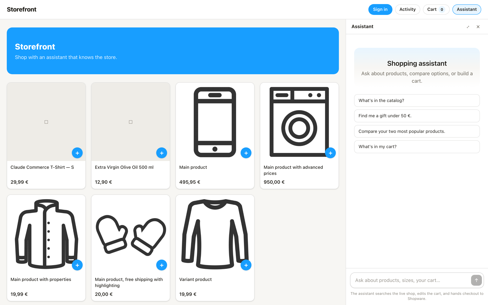

# Storefront web UI

Next.js 16 grid, cart drawer, and assistant rail on top of the shared UI in `vendor/web-shared`
(read-only, vendored from upstream `examples/web-shared`). Talks to the Shopware storefront API on
port 8004.



## Run

```bash
# from the repo root
npm install
npm run dev:storefront        # http://localhost:3005
npm run build -w storefront/web
```

| Variable | Default | Purpose |
|---|---|---|
| `NEXT_PUBLIC_API_URL` | `http://localhost:8004` | Origin of the storefront API; every call goes to `${NEXT_PUBLIC_API_URL}/api/...`. |

Chat needs `ANTHROPIC_API_KEY` on the API side. Grid, cart, and Shopware account login work without it.

## What it calls

Shared routes (`vendor/demo_common`), through `AgentApi` from `web-shared`:

- `POST /api/session`, `POST /api/chat` (SSE), `GET /api/products`, `GET /api/products/{id}`, `GET /api/cart`, `GET/PATCH /api/memory`

Shopware-specific routes (`storefront/api/main.py`):

| Route | Used by | Notes |
|---|---|---|
| `GET /api/cart`, `POST /api/cart/add` | `StoreShell`, `ProductTile` | The cart payload carries `checkout_url`; `cart_id` is exposed only for guest cart restoration, never for a signed-in customer's token. |
| `POST /api/cart/attach` | `StoreShell` (`?cart=<id>` or `sessionStorage`) | Binds the session to an existing Shopware cart (context token). 404 → the id is dropped. |
| `GET /api/auth/status` | `lib/session.ts` | Revalidates a stored session id on load and drives the signed-in badge. |
| `POST /api/auth/shopware/login` | `Header` → `signIn(email, password)` | Shopware validates the credentials; the host binds the verified account and its shipping address to the session. |
| `POST /api/auth/signout` | signed-in badge | Ends the account session and returns a fresh guest session id. |
| `GET /api/brand` | `StoreShell`, `Header` | Store name, tagline, logo, and brand colours (`--brand`, `--brand-contrast`). |
| `POST /api/session/sync-catalog` | `lib/session.ts` after start | Listing search through the executor so grid titles enter chat provenance. |

Product ids are Shopware's 32-hex UUIDs; prices are EUR and rendered with `de-DE` formatting via
`lib/format.ts` (the shared `formatMoney` is en-US/USD, so the app never uses it).

## Checkout handoff

"Checkout in Shopware" (cart drawer and the assistant's checkout card) is a plain `<a href>` to
`cart.checkout_url`, opened **in the same tab**. The URL points at the storefront API's own handoff
page (`GET /api/checkout/continue/<ticket>`), which auto-submits a POST form to Shopware's checkout.
A `fetch`, a popup, or `target="_blank"` would not follow that form, so the link stays a normal
navigation. `isSafeCheckoutUrl` only lets `http(s):` URLs through. Nothing is charged in the agent.

## Orders and identity

`Sign in` opens a Shopware email/password form. The API verifies it through the Store API and
requires a complete default shipping address before binding the customer id to the session.
The session id lives in `sessionStorage`; sign-out replaces it and clears the remembered cart.
The `user_id` field sent at session start is ignored by this storefront host; anonymous
memory keys are unique and the signed-in memory key comes from the verified customer.
The assistant shows a checkout summary when asked to review the cart and submits an order
when explicitly asked to buy or place an order. Order submission requires sign-in, does
not process payment, and reports that the order was placed after the
shop confirms the order. Order history is scoped to the verified customer.

## web-shared deltas this app adapts to

- `new AgentApi(root, prefix)` — two arguments; `api.startSession()` resolves `{ sessionId, ... }`.
- `Chat` renders only the transcript; the input is `Composer` (`web-shared/Composer`), which the
  rail mounts itself. `ActivityButton` is imported from `web-shared/ActivityButton`.
- `globals.css` imports `web-shared/base.css` and defines the full token set the shared components
  read (`--ground`, `--chrome`, `--ink-2`, `--line-strong`, `--accent-ink`, shadows, …).

## Files

| Path | Role |
|---|---|
| `app/page.tsx`, `app/products/[id]/page.tsx` | Grid and product detail |
| `components/StoreShell.tsx` | Session, brand, cart state, chat events, sign-in state |
| `components/Header.tsx` | Brand, sign-in / signed-in badge, activity, cart, assistant toggles |
| `components/CartDrawer.tsx` | Cart lines, quantity, "Checkout in Shopware" |
| `components/Assistant.tsx` | Rail: shared `Chat` + `Composer`, generative cards |
| `components/generative/*` | Product strip, comparison, checkout, order status, plan, guide cards |
| `lib/api.ts`, `lib/session.ts`, `lib/format.ts`, `lib/types.ts` | API client, session, EUR formatting, payload types |
